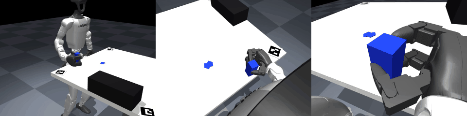
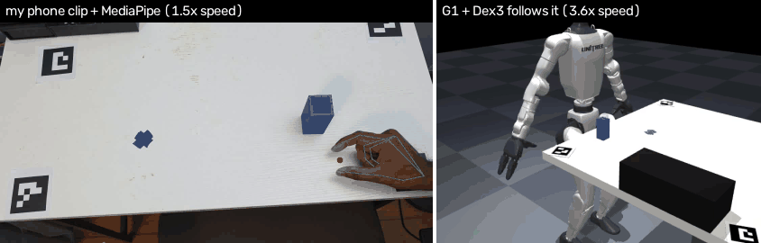
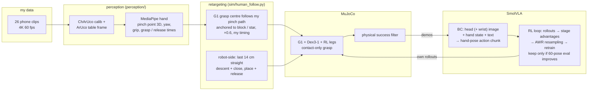

# An RL-Fine-Tuned VLA for Humanoid Manipulation: From Egocentric Phone Data

* **My data:** 26 phone clips of me picking up a block and putting it on a star. My hand is tracked with MediaPipe.
* **What it drives:** a Unitree G1 humanoid with a Dex3-1 hand in MuJoCo. The robot follows my hand path, the
  resulting demos train SmolVLA, and the VLA is then improved with RL on its own rollouts.
* **Result:** 52 % success on 60 unseen block poses, from cameras only. Contact-only grasp (no welds), 0 falls.
  A benchmark trained on motion-planner demos reaches 73 %.



*Attempt 1 final model (head + wrist cameras, after RL). The VLA alone drives the arm and hand, my RL leg policy keeps the robot standing, and the block is held only by contact and friction.*

| | what drives the arm in the demos | success (60 unseen poses) | lifted | falls |
|---|---|---|---|---|
| **Attempt 1**: my hand motion → SmolVLA → RL | **my recorded hand path**, retargeted | **52 %** (head + wrist) / 45 % (head only) | 67 % / 55 % | 0 |
| Attempt 2 (benchmark): planner/IK demos → SmolVLA | a motion planner; my clips give only the block poses | 73 % (30 poses) | 90 % | 0 |

Trained models on Hugging Face: [attempt 1, head + wrist (final)](https://huggingface.co/adityamohan2604/g1-smolvla-attempt1-wrist) ·
[attempt 1, head only](https://huggingface.co/adityamohan2604/g1-smolvla-attempt1-head) · [attempt 2](https://huggingface.co/adityamohan2604/g1-smolvla-attempt2-ik-demos).
How to download and evaluate them: section 2 "Run it" and section 3.

---

## 0. Setup: robot, hand, task, my data

| | |
|---|---|
| Robot | **Unitree G1** humanoid, 29 DoF (legs 12, waist 3, arms 2 × 7), full floating base, MuJoCo 3.15 |
| Hand | **Unitree Dex3-1**, 3 fingers (thumb, index, middle), 7 DoF, on the right arm. Meshes, masses and joint ranges from MuJoCo Menagerie; position servos with Unitree's torque limits (2.45 / 1.4 N m) |
| Arms | only the right arm manipulates; the left arm holds its rest pose |
| Legs + waist | my RL stance policy (ONNX, 50 Hz), section 1 |
| Cameras | head camera (G1's D435 position, 224 × 224); **wrist camera** on the right wrist (added for attempt 1's final model; the real G1 has none) |
| Physics | elliptic friction cone, impratio 10, 5 ms step. With the default pyramidal cone a held block slowly crept out of a 76 N grip; I measured this and fixed it. **No welds or attachments**: the block is held by finger contact only |
| Task | pick up a 3.5 × 3.5 × 8 cm, 80 g standing block and put it upright on the star |
| Success | block upright on the star (≤ 3 cm), robot standing, no robot body part except the hand touching the table |
| **My data** | **26 phone clips** (4K, 60 fps; phone on a stand at my eye level, me standing directly behind it) of me doing the task at different block positions and orientations, plus ChArUco calibration videos; ArUco markers on the table give the table frame (`common/data/raw/`, not in git: 2.4 GB) |

---

## 1. Legs: a quick RL stance policy so the robot stays up while it picks and places

A humanoid at a table is not a fixed-base arm. Every arm motion pushes the body. I trained a leg + waist policy
(PPO in [mjlab](https://github.com/mujocolab/mjlab)) that holds the robot still and balanced while *something else*
moves the arms: a VLA, IK or teleop.

* **Training** (task `Mjlab-Velocity-HumanV2-StancePalmIn-Unitree-G1`, 4096 parallel envs): stand-only commands;
  table-work postures (height 0.68–0.80 m, lean, waist yaw); random arm motions (reach / pick / carry), with 70 % of the
  right arm's reach goals being palm-in grasp poses like the ones the task needs; light payloads (0.2–3 kg) picked up and
  put down mid-episode; domain randomisation and pushes.
* **Rewards:** velocity / posture tracking plus strongly weighted standing-still terms (stillness 4, base motion 4,
  stand contact 4, foot drag −1).
* **Policy** `common/policy/stance_palmin.onnx`: observations 752 → actions 15 (12 leg + 3 waist joints). The arms are PD-controlled with gravity feed-forward. The legs
  policy sees the arm targets, so it can anticipate them.

Files: task configs and rewards in `common/rl_legs/mjlab_tasks/human_v2_posture/env_cfg.py` (stance tasks) and
`.../human_v2/mdp/rewards.py`, the mjlab patch `common/rl_legs/mjlab_velocity_g1.patch`, the training script
`common/rl_legs/scripts/train_posture.sh`, the ONNX policy in `common/policy/`,
and the runtime (`StanceRobot`: legs + arm interface + cameras) in `common/stance/stance_runner.py`.

**Where the hand can work** (`common/stance/workspace_map.py`): the Dex3 grasp centre is moved to every point of a 5 cm
grid on the table at grasp height (palm-in, as in both attempts) and held for 3 s.
Result: **the feet never moved more than 1.1 cm and the robot never fell at any of the 66 points.** The workspace is limited by the arm, not by balance. What changes is how much the pelvis sways to balance the arm.

`#` reached (< 1 cm), pelvis sway ≤ 4.5 cm (fully stable) · `+` reached, pelvis sways 4.5–6 cm (stable, body compensates) · `~` hand stops 1–3 cm short (arm at full extension, sway up to 8 cm) · `.` more than 3 cm short · `x` arm would hit the torso.
x is forward from the pelvis and y is left; the table edge is at x = 0.19 m. Raw numbers: `common/data/workspace_map.json`.

```
y (m, left +)  -0.35 -0.30 -0.25 -0.20 -0.15 -0.10 -0.05 -0.00 +0.05 +0.10 +0.15
x = 0.45 m       .     .     .     .     .     .     .     .     .     x     x  
x = 0.40 m       .     .     .     .     .     ~     #     +     x     x     x  
x = 0.35 m       .     .     .     ~     #     #     #     x     x     x     x  
x = 0.30 m       .     .     ~     +     #     #     #     x     x     x     x  
x = 0.25 m       .     .     ~     +     #     +     +     x     x     x     x  
x = 0.20 m       .     ~     +     +     #     +     x     x     x     x     x  
```

The block spawns in the pickup region (x 0.20–0.35, y −0.23 … −0.11 m), which is inside the `#` / `+` area (its far right corner at y −0.23 is at the edge of `~`). The star is at (0.38, 0.00), between the `#` and `+` cells at x = 0.40. The test is a static 3 s hold without a block. A fast carry with an 80 g block pushes the body more, but in the full pick-and-place evaluations (3 × 60 episodes in attempt 1, 30 in attempt 2) the robot never fell.

---

## 2. Attempt 1: my hand motion → SmolVLA → RL (`attempt_1_vla_rl/`)



*Left: one of my phone clips, with the tracked hand, pinch point (red) and grip/yaw readout. Right: the G1 + Dex3
replaying that clip in physics (`sim/human_follow.py`): my path, turn and grip timing, scaled to the robot. This replay:
block placed 1.7 cm from the star, upright. The panels run at different speeds because the robot plays my motion 2×
slower, pauses to close the Dex3 and moves from / to its rest pose.*

### Why this design
* **The challenge asks that my data drive the robot.** So my hand *path* (where it goes, how it turns, when it closes
  and opens, and how fast) becomes the robot's motion, and not just the block positions.
* **Hand-pose actions, not joint angles.** The robot is standing on its own legs, and its pelvis sways several cm
  while the arm moves (section 1). So the VLA outputs the grasp-centre pose (x, y, z, yaw, grip) in the **table frame**,
  and IK from the *current* torso pose turns it into joint angles. The action means the same thing however the body has
  moved.
* **RL on top of imitation**, after Larchenko 2026, *Learning to Fold* (arXiv 2606.27163). SmolVLA is a
  flow-matching policy, like theirs. Their argument: policy-gradient updates push the action chunk off the small
  manifold of valid actions, while **advantage-weighted regression through the data sampler** only re-weights actions the
  policy already produces. It is cheap, stable and needs no change to the LeRobot training loop. I copied the AWR sampler
  and replaced their learned value with an empirical stage value from the simulator. I skipped their RECAP token, CFG
  and async flywheel (one 8 GB laptop GPU).

### How information flows



### Steps
1. **Perception** (`perception/`, `.venv_perc`). Camera calibration 1.31 px RMS. MediaPipe 21 hand landmarks → the
   **pinch point** (thumb tip / index tip midpoint) in 3D, hand yaw, grip aperture (0..1), and the grasp / release
   moments (when the block starts / stops moving). Monocular depth comes from MediaPipe's metric hand model + PnP, with one
   scale per clip. **18 of 26 clips** give a usable track. Example overlay:
   `attempt_1_vla_rl/data/tracks/blue_cube_20261011_112209_overlay.mp4`.
2. **Retargeting** (`sim/human_follow.py`, `sim/make_human_demos.py`). Two anchors map exactly: my pinch at my grasp →
   the robot's grasp point on its block, and my pinch at my release → the drop point. Between them my hand's excursion is
   kept in direction and timing, scaled ×0.6 (the G1's arm is shorter and it stands back from the table) and played 2×
   slower (1.2× while carrying). Hand yaw = block face yaw + my yaw change since the grasp. My grip signal blends the Dex3
   from open to a 3-point squeeze. Each clip is replayed at 50 random block poses.
3. **Robot-side corrections, reported, not hidden.** A Dex3 is not a human hand. The last 14 cm of the approach is
   straight down onto the block, with a pause to close. Over the star the hand settles, then descends for 2 s and
   releases on touch-down. The anchors use the simulator's true block / star pose.
4. **Physical filter.** A demo is kept only if the block ends upright on the star, the robot is standing and no body
   part except the hand touched the table.
5. **SmolVLA BC** (450M, `lerobot/smolvla_base`). Inputs: head camera (+ wrist camera), state = grasp centre xyz + yaw +
   grip, and the text "pick up the blue block and put it on the blue star". Output: chunks of 5-D hand-pose actions,
   re-planned every 5 steps (0.2 s). **The VLA is never given the block pose** (`sim/eval_vla.py`): it has to find the
   block in the camera images. The simulator's block pose is used only by the demo generator (like a teleoperator who
   can see the block) and to label RL rollouts.
6. **RL loop** (`rl/`). The VLA alone runs on fresh random poses, and every frame is labelled with privileged progress
   stages (hand at grasp point → lifted → over star → placed). The advantage of a frame in stage k is
   V(k+1) − V(k) if the episode got further, else outcome − V(k), with V(k) = P(success | reached k). There is extra
   negative credit for the second before the block is knocked over. Frames are sampled ∝ exp(A) and the loss stays plain
   flow matching. **A new model is kept only if its 60-pose eval beats its parent.**

**What the demos contain** (share of training frames):

| source | share |
|---|---|
| **my motion** (path, yaw, grip, timing) | **54 %** |
| robot-side grasp (last 14 cm + close) | 20 % |
| robot-side place (settle, descend, release) | 26 % |

### Iterations (every row: the same 60 unseen block poses, seed 123)

| # | model | data | cameras | success | lifted | kept? |
|---|---|---|---|---|---|---|
| 1 | BC v0 | 302 demos v1 | head | 0 / 16 (stopped) | 6 % | no: action-interface bug |
| 2 | BC v1 | 572 demos v2 | head | 37 % | 52 % | yes (baseline) |
| 3 | RL it1 | + 120 own rollouts | head | tie (30 poses) | 50 % | rolled back |
| 4 | **RL it2** | + 240 own rollouts | head | **45 %** | 55 % | **yes: final head-only** |
| 5 | RL it3 | + 240 more rollouts | head | 38 % | 58 % | rolled back |
| 6 | all-demos AWR round | 1151 demos + rollouts | head | 42 % | 53 % | no |
| 7 | wrist BC (init from it2) | 584 demos v4 (re-simulated with the wrist camera) | head + wrist | 43 % | 58 % | yes (new branch) |
| 8 | **wrist RL it11** | + 60 own rollouts | head + wrist | **52 %** | 67 % | **yes: final** |

n = 60 gives about ±6 % (1 SD), so each gain of about +8 points is roughly 1.3 SD. The lift rate rose with it.

### Why a wrist camera, and what it did
After three RL rounds I measured *where* the policy fails. It fails at the grasp: when the fingers close 2–4 cm off the
grasp point, only 43 % of blocks are lifted, against 81 % when the error is under 1 cm.

<details><summary>Grasp error vs lift rate (198 rollouts)</summary>

| grasp-centre error when the grip closes | rollouts | lifted |
|---|---|---|
| < 1 cm | 26 | **81 %** |
| 1–2 cm | 44 | 66 % |
| 2–4 cm | 86 | **43 %** |

</details>

In the 224 px head image the block is about 14 px wide (1 cm ≈ 4 px), and the hand covers half of it at the grasp. RL can
only re-weight what the policy can see. So I added a wrist camera:

| | head only (RL it2) | head + wrist (BC) | head + wrist (RL it11) |
|---|---|---|---|
| reaches the grasp point | 77 % | 88 % | |
| lifted | 55 % | 58 % | **67 %** |
| success | 45 % | 43 % | **52 %** |
| median place error (successes) | 1.1 cm | 1.1 cm | 1.4 cm |
| falls | 0 | 0 | 0 |

### What did not work
<details><summary>What failed, and what I changed</summary>

* **v1 demos succeeded only 34 % of the time in sim.** Traced per step: the ×0.6 carry lifted the block only 0.5–3 cm,
  fast approaches knocked it over, and the hand oscillated over the star. The robot-side grasp and place fixes raised it
  to 64 %. A stronger squeeze was *worse*.
* **BC v0 = 0 %** was not a learning problem. The planned segments stored the planner's final goal as the action. Replaying
  successful demos' own actions through the eval controller also gave 0/6. That made it a bug, which I fixed.
* **The RL loop helped in 2 of 5 rounds.** The gains are close to the eval noise. AWR sharpens what is already there and
  cannot fix a 2–4 cm grasp error.
* **Doubling the head-camera demos** (572 → 1151) did not help (42 % vs 45 %).
* **The wrist camera alone did not help at first** (43 %). My demos never show a correction ("the hand is 3 cm off →
  move it"), because the robot-side grasp uses the true block pose. Next step: DAgger-style data, where the VLA drives
  and a scripted corrector takes over near the block.
* **Lying blocks** (10 of my clips) are not handled. The Dex3 would need an extreme arm pose that makes the legs step.

</details>

### Run it
```bash
# environments (Python 3.10): VLA + eval, and perception / demo generation
python -m venv .venv_vla  && .venv_vla/bin/pip install "lerobot[smolvla]==0.4.4" mujoco==3.15.0 onnxruntime opencv-python-headless
python -m venv .venv_perc && .venv_perc/bin/pip install mujoco==3.15.0 onnxruntime mediapipe opencv-python scipy

# download the trained models (public, no login needed)
.venv_vla/bin/hf download adityamohan2604/g1-smolvla-attempt1-wrist --local-dir models/attempt1_wrist
.venv_vla/bin/hf download adityamohan2604/g1-smolvla-attempt1-head  --local-dir models/attempt1_head

cd attempt_1_vla_rl
# evaluate the final model on the 60 test poses (4 processes) / record a video (front | head | wrist)
rl/run_eval.sh ../models/attempt1_wrist data/eval/my_eval.json 60 123 4 --n-action-steps 5
../.venv_vla/bin/python sim/eval_vla.py --policy ../models/attempt1_wrist --episodes 4 --seed 123 \
    --n-action-steps 5 --video out.mp4 --video-all
# head-only model: same commands with ../models/attempt1_head
```
Pass a local folder to `--policy`, not the Hub ID: the eval reads the model's `train_config.json` to decide whether to
feed the wrist camera.

<details><summary>Full pipeline, from my clips to the final model</summary>

```bash
cd attempt_1_vla_rl
../.venv_perc/bin/python perception/calibrate.py          # camera calibration
../.venv_perc/bin/python perception/hand_track.py         # hand tracks -> data/tracks
train/gen_v4.sh 12 50                                      # demos (12 processes x 50 poses per clip, with wrist camera)
../.venv_vla/bin/python sim/to_lerobot.py --src data/human_demos_v4 --root data/lerobot/g1_dex3_wrist_v4
train/train_smolvla_wrist.sh 12000 16 data/lerobot/g1_dex3_wrist_v4 <init>   # BC
NAS=5 rl/loop_v.sh ...                                     # RL rounds: rollouts -> advantages -> AWR -> eval -> keep / roll back
```
</details>

Trained models (Hugging Face): [g1-smolvla-attempt1-wrist](https://huggingface.co/adityamohan2604/g1-smolvla-attempt1-wrist) (head + wrist, final) and [g1-smolvla-attempt1-head](https://huggingface.co/adityamohan2604/g1-smolvla-attempt1-head) (head only).

---

## 3. Attempt 2 (benchmark): planner/IK demos → SmolVLA (`attempt_2_ik_demos_vla/`)

**This was actually my first attempt, but it does not meet the challenge's main constraint**: the arm motion in the
demos comes from a motion planner, not from me. My clips only supply the **block poses** (position, yaw,
standing/lying, from a silhouette fit of the known box). I keep it as a **benchmark and reference**: the same robot,
legs, scene and SmolVLA, trained on perfectly consistent demos. It shows what the G1 + Dex3 can do here, and it is how I
learned what the grasp, the legs and the physics need.

* **Demos:** each clip's block pose is mapped into the pickup region, with jitter, plus 128 uniform random poses. The arm
  uses RRT-Connect on the exact scene geometry (`common/sim/planner.py`) for free-space moves, and straight closed-loop IK
  lines near the table (re-solved every step from the current torso pose, because the body sways about 9 cm). The grasp is
  palm-in, with the hand turned to the block's yaw and a 3-point grip (thumb vs index + middle). An in-hand calibration
  makes the *block* centre land on the star. The same physical filter applies. **466 demos** (77 % of attempts passed).
* **Policy:** SmolVLA, head camera, **joint-space** actions (7 arm + 7 Dex3 joints), 2 rounds × 20k steps (~4 h on an
  RTX 4060 laptop GPU).
* **Result:** **73 % (22/30)**, lifted 90 %, median place error 1.5 cm, 0 falls. Failures: extreme yaws (±17–23°).

Video of the evaluation: `attempt_2_ik_demos_vla/data/eval_vla_r2.mp4`.
```bash
.venv_vla/bin/hf download adityamohan2604/g1-smolvla-attempt2-ik-demos --local-dir models/attempt2_ik_demos
cd attempt_2_ik_demos_vla
../.venv_vla/bin/python sim/eval_vla.py --policy ../models/attempt2_ik_demos --episodes 30 --out data/my_eval.json
```
Model: [g1-smolvla-attempt2-ik-demos](https://huggingface.co/adityamohan2604/g1-smolvla-attempt2-ik-demos).

---

## 4. Comparison

Both evaluations draw block poses from the same generator and seed, so attempt 2's 30 test poses are exactly
the first 30 of attempt 1's 60.

| | Attempt 1 head + wrist (RL it11) | Attempt 1 head only (RL it2) | Attempt 2 planner/IK demos |
|---|---|---|---|
| arm motion in the demos comes from | **me** (54 % of frames) + scripted grasp / place | **me** + scripted grasp / place | a motion planner |
| demos | 584 (+ 60 own rollouts) | 572 (+ 240 own rollouts) | 466 |
| action space | grasp-centre pose (IK below) | grasp-centre pose | 14 joint angles |
| success, same 30 poses | 47 % (14/30) | 40 % (12/30) | **73 % (22/30)** |
| success, 60 poses | **52 %** | 45 % | n/a |
| lifted (60 / 30 poses) | 67 % | 55 % | 90 % |
| falls | 0 | 0 | 0 |
| main failure | grasp precision (2–4 cm off) | grasp precision | extreme block yaw |

**Takeaways.**
1. Consistent planner demos give the higher score. My own motion varies from clip to clip and is noisier, so it costs
   about 25 points.
2. Attempt 1 is the one that meets the brief: my recorded motion is what the robot does, and the VLA learns it.
3. RL on the VLA's own rollouts gave real but small gains. The wrist camera mattered once RL could build on it.
4. The next lever is not more RL but correction data (DAgger) at the grasp.

---

## Repo layout
```
common/                       shared by both attempts
  robot/                      G1 + Dex3-1 MJCF and meshes
  scene/                      table scene builder (layout.py: table, pickup region, star)
  stance/                     StanceRobot runtime (legs ONNX + arm PD + cameras), arm IK, workspace_map.py
  policy/                     leg policy (stance_palmin.onnx), IK tables
  rl_legs/                    mjlab task configs, rewards, patch and scripts for training the leg policy
  sim/                        RRT-Connect planner, teleop / inspection tools
  data/                       calibration, annotations, poses (raw videos not in git)
attempt_1_vla_rl/             perception/, sim/ (retargeting, demos, eval), rl/, train/, media/, data/eval + tracks
attempt_2_ik_demos_vla/       sim/ (planner demos, eval), train/, data/ (evals, videos)
```
